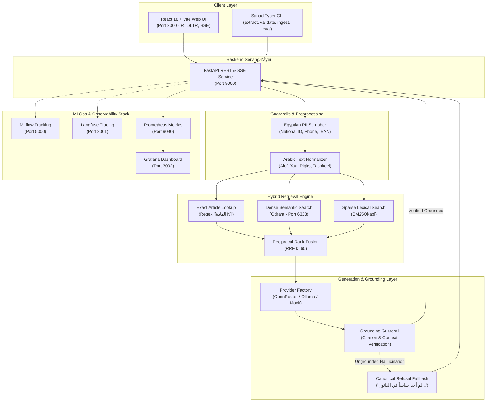

# Sanad (سند) — Arabic Legal Q&A System

[](https://github.com/iti-mlops-mena)
[](.github/workflows/ci.yml)
[](backend/tests/)
[](backend/pyproject.toml)
[](frontend/)
[](https://qdrant.tech/)

> **سند (Sanad)** هو نظام بحث واستشارات قانونية مدعوم بالذكاء الاصطناعي موجه إلى **القانون المدني المصري (قانون رقم 131 لسنة 1948)**.  
> يقوم النظام باسترجاع النصوص التشريعية بدقة وتأصيل الإجابات حصراً منها مع توثيق أرقام المواد (مثل `[المادة 147]`). في حالة عدم كفاية النص القانوني المسترجع، يمتنع النظام قطعياً عن التأليف أو التخمين ويعلن تعذر وجود أساس قانوني (Strict Refusal Fallback).

---

## 📑 Table of Contents
1. [Project Overview & Key Highlights](#-project-overview--key-highlights)
2. [System Architecture](#️-system-architecture)
3. [Prerequisites & System Requirements](#-prerequisites--system-requirements)
4. [Execution Modes (Live vs. Mock Mode)](#-execution-modes)
5. [Step-by-Step Clean-Machine Setup](#-step-by-step-clean-machine-setup)
   - [Method 1: Docker Compose (Recommended)](#method-1-docker-compose-recommended)
   - [Method 2: Native Local Development](#method-2-native-local-development)
6. [Corpus & Vector Indexing](#-corpus--vector-indexing)
7. [Verification & Sample Queries](#-verification--sample-queries)
8. [Automated Quality Gate & Testing](#-automated-quality-gate--testing)
9. [Troubleshooting Guide](#-troubleshooting-guide)
10. [Repository Structure & ADRs](#-repository-structure--adrs)

---

## 📌 Project Overview & Key Highlights

- **1,149 Articles Full Coverage**: Geometry-aware bilingual parser extracting Articles 1–1149 from the source Egyptian Civil Code PDF into contiguous structured JSON (`data/processed/articles.json`) with **0 missing records**.
- **Repealed Articles Tracking**: Articles 54–80 (Law 384/1956) and Articles 389–417 (Evidence Law 25/1968) are systematically cataloged with statutory repeal annotations.
- **Strict Grounding Guardrail**: Strict post-generation lexical and semantic verification. Any hallucinated citation triggers canonical refusal fallback (`لم أجد أساساً في القانون المدني للإجابة عن هذا السؤال`).
- **Hybrid Retrieval Engine**: Reciprocal Rank Fusion ($k=60$) combining Qdrant dense vector search, BM25Okapi sparse lexical search over normalized Arabic, and exact deterministic article lookup (`[المادة N]`).
- **Zero-Key Mock Mode**: Ready for offline execution and grading out-of-the-box (`MOCK_MODE=true`), using local BM25 + deterministic statutory synthesis and passing quality gate evaluation with zero external dependencies.
- **Full MLOps Lifecycle**:
  - **CI/CD Automation**: GitHub Actions pipeline checking Ruff formatting, Mypy typing, backend pytest (>70% coverage gate), and frontend TypeScript/Vitest builds.
  - **RAGAS Quality Gate**: Automated evaluation enforcing Faithfulness $\ge 0.75$ on the benchmark dataset.
  - **Distributed Observability**: OpenTelemetry-compatible tracing with Langfuse, Prometheus metrics export (`/metrics`), and pre-provisioned Grafana dashboards.
  - **Semantic Drift Detection**: Two-sample Kolmogorov-Smirnov (KS-test) and cosine distance drift detection against the corpus centroid.

---

## 🏗️ System Architecture



---

## 💻 Prerequisites & System Requirements

Reviewers can run this project on any standard development machine or cloud VM:

| Component | Minimum Requirement | Recommended |
| :--- | :--- | :--- |
| **Operating System** | Linux (Ubuntu 20.04+), macOS 12+, Windows 10/11 with WSL2 | Ubuntu 22.04 LTS / Debian 12 |
| **Python** | 3.11.x | 3.11.16 / 3.11.17 |
| **Node.js** | Node.js 20.x + npm 10.x *(only for native frontend run)* | Node 20 LTS (handled inside Docker) |
| **Docker & Compose** | Docker 24.0+ and Docker Compose v2.20+ | Docker Engine 26+ |
| **RAM** | 8 GB RAM | 16 GB RAM (for running all 7 Docker containers simultaneously) |
| **GPU** | **No GPU required** (Zero GPU dependencies; runs via API or CPU BM25) | CPU-only is 100% supported |
| **Disk Space** | 5 GB free disk space | 10 GB free disk space |

### Port Allocations

Ensure the following local ports are free before starting services:

| Port | Service | Description | URL |
| :--- | :--- | :--- | :--- |
| `3000` | **Frontend Web UI** | React 18 bilingual client interface | http://localhost:3000 |
| `8000` | **Backend API** | FastAPI REST endpoints and OpenAPI Swagger | http://localhost:8000/docs |
| `6333` | **Qdrant Vector DB** | REST API & Web Dashboard | http://localhost:6333/dashboard |
| `5000` | **MLflow Tracking** | Experiment logs and model registry | http://localhost:5000 |
| `3001` | **Langfuse Tracing** | LLM execution traces and latency breakdown | http://localhost:3001 |
| `3002` | **Grafana** | Real-time Prometheus metrics visualization | http://localhost:3002 (`admin`/`admin`) |
| `9090` | **Prometheus** | Metrics scraper and time-series store | http://localhost:9090 |

---

## 🎛️ Execution Modes

You can run Sanad in **either** of the following two modes:

### Option A: Live Cloud LLM Mode (Recommended)
- **Requires**: An OpenRouter free-tier API key (`OPENROUTER_API_KEY`).
- **Free Key Signup**: Get a free API key at [https://openrouter.ai/keys](https://openrouter.ai/keys) (Takes ~30 seconds, no credit card required).
- **Models Configured in `config/models.yaml`**:
  - Default Chat: `nemotron-ultra-free` (`nvidia/nemotron-3-ultra-550b-a55b:free`)
  - Alternative Chat: `gemma-4-free` (`google/gemma-4-31b-it:free`)
  - Default Embeddings: `nemotron-embed-free` (`nvidia/nemotron-3-embed-1b:free`, 2048d)
  - Alternative Embeddings: `liquid-lfm-embed-free` (`liquid/lfm-2.5-embedding-350m:free`, 1024d)
- **Behavior**: Real-time generation, dense semantic search via Qdrant, and live citations.

### Option B: 100% Offline Mock Mode (Zero Keys Needed)
- **Requires**: **Zero external accounts, zero API keys, zero network calls**.
- **How to Activate**: Either set `MOCK_MODE=true` in `.env`, or leave `OPENROUTER_API_KEY` empty (Sanad automatically falls back to Mock Mode).
- **Behavior**:
  - Retrieval: Local BM25Okapi keyword search over `data/processed/articles.json` (Egyptian Civil Code).
  - Generation: Deterministic statutory legal synthesis citing exact article numbers.
  - Evaluation: Deterministic quality scoring passing the quality gate in < 3 seconds. Mock evaluation outputs are isolated in `reports/mock/` and clearly labeled `"MOCK: deterministic placeholder scores, NOT a real RAGAS evaluation"`, preserving real benchmark reports in `reports/ragas_results.json`.

---

## 🚀 Step-by-Step Clean-Machine Setup

Follow these exact steps in order:

### Step 1: Clone the Repository
```bash
git clone https://github.com/Youssefx64/sanad-legal-qa.git
cd sanad-legal-qa
```

### Step 2: Environment Configuration
Copy the template configuration file:
```bash
cp .env.example .env
```

### Step 3: Configure `.env`
Open `.env` in any text editor and choose your mode:

#### For Option A (Live Keys):
```bash
# Add your OpenRouter free-tier key
OPENROUTER_API_KEY=sk-or-v1-your-free-key-here
MOCK_MODE=false
```

#### For Option B (Mock / Offline Mode - Zero Keys):
```bash
# Leave OPENROUTER_API_KEY empty or set MOCK_MODE=true
OPENROUTER_API_KEY=
MOCK_MODE=true
```

> [!NOTE]
> All other variables (`ADMIN_API_KEY`, `QDRANT_URL`, `MLFLOW_TRACKING_URI`, etc.) already have safe local defaults pre-configured for instant development.

---

### Method 1: Docker Compose (Recommended)

This single command builds and starts the entire 7-service stack (Vector Store, Backend, Frontend, MLflow, Langfuse, Prometheus, Grafana) in the proper dependency order:

```bash
# Start all containers in background
docker compose -f infra/docker-compose.yml up -d --build
```

#### Verify Container Status:
```bash
docker compose -f infra/docker-compose.yml ps
```
*All containers (`sanad-backend`, `sanad-frontend`, `sanad-qdrant`, `sanad-mlflow`, `sanad-langfuse`, `sanad-prometheus`, `sanad-grafana`) will report `Up` / `healthy` within 15–30 seconds.*

#### Check Service Sanity:
```bash
./infra/check_services.sh
```

---

### Method 2: Native Local Development (Without Docker)

If you prefer to run natively on your machine:

#### 1. Backend Setup:
```bash
# Create and activate Python 3.11 virtual environment
python3.11 -m venv .venv
source .venv/bin/activate

# Upgrade pip and install backend packages
pip install --upgrade pip
pip install -e "./backend[dev,mlops]"
```

#### 2. Start Local Vector Store (Qdrant):
```bash
docker run -d --name sanad-qdrant -p 6333:6333 -p 6334:6334 qdrant/qdrant:latest
```
*(Skip this step if running in `MOCK_MODE=true` as Qdrant is not required).*

#### 3. Start Backend API Server:
```bash
# Set Python path and start Uvicorn
export PYTHONPATH=backend/src
uvicorn sanad.api.app:app --host 0.0.0.0 --port 8000 --reload
```

#### 4. Frontend Setup (In a separate terminal):
```bash
cd frontend
npm install
npm run dev
```
*Frontend will be live at `http://localhost:5173` (or `http://localhost:3000`).*

---

## 📚 Corpus & Vector Indexing

The complete Egyptian Civil Code corpus is pre-extracted and committed in the repository (`data/processed/articles.json` containing all 1,149 articles and `data/raw/egyptian_civil_code_1948.pdf`). **No external DVC/S3 pull is required.**

### 1. Validate Corpus Integrity:
```bash
python -m sanad.cli validate
```
**Expected Output:**
```
Validation PASSED: All 1149 articles conform to schema.
```

### 2. Index Articles into Vector Database:
```bash
python -m sanad.cli ingest
```
- In **Live Mode**: Chunks and embeds all 1,149 articles into Qdrant collection `nemotron_embed_free_1536_...`.
- In **Mock Mode**: Validates corpus chunks and initializes local BM25 index with zero network overhead.

---

## 🔍 Verification & Sample Queries

### 1. Health Check
```bash
curl -s http://localhost:8000/health | jq .
```
**Expected Response:**
```json
{
  "status": "ok",
  "version": "0.1.0",
  "mock_mode": true,
  "qdrant_connected": true,
  "articles_count": 1149
}
```

### 2. Test Statutory Legal Query
Query the API via `curl`:
```bash
curl -X POST http://localhost:8000/api/v1/ask \
  -H "Content-Type: application/json" \
  -d '{"question": "ما هي شروط صحة الرضا في العقد؟"}' | jq .
```

**Expected Response Shape:**
```json
{
  "answer": "وفقاً لأحكام [المادة 123] من القانون المدني المصري: لا يؤثر في صحة العقد مجرد الغلط في الحساب...",
  "citations": [
    {
      "article_number": 123,
      "title_ar": "المادة 123",
      "citation": "Egyptian Civil Code, Article 123",
      "is_grounded": true
    }
  ],
  "grounding": {
    "is_grounded": true,
    "confidence_score": 1.0,
    "reason": "Deterministic statutory synthesis"
  },
  "latency_ms": 12.5,
  "chat_model_id": "nemotron-ultra-free"
}
```

### 3. Test Web Interface
1. Open your browser at **[http://localhost:3000](http://localhost:3000)**.
2. Select any suggested prompt (e.g. *"ما هي شروط صحة الرضا في العقد؟"* or *"ما هو أثر القوة القاهرة على تنفيذ الالتزام؟"*).
3. Observe real-time token streaming, citation badges `[المادة 147]`, and click on any citation badge to view the full verified legal text.
4. Switch to the **تصفح نصوص القانون (Article Browser)** tab to browse through all 1,149 articles with search and book/chapter filters.

---

## 🧪 Automated Quality Gate & Testing

### 1. Run Evaluation Quality Gate
Sanad includes an automated statutory quality gate evaluating Faithfulness, Answer Relevancy, Precision, Recall, and Latency:

```bash
# If running with Docker Compose (Recommended):
docker compose -f infra/docker-compose.yml exec backend python -m sanad.cli eval --subset ci --gate

# Or if running in a native Python virtual environment:
python -m sanad.cli eval --subset ci --gate
```

**Expected Console Output (Mock Mode):**
```
============================================================
SANAD EVALUATION QUALITY GATE
============================================================
Evaluated Samples:     20
Faithfulness Score:    0.9525  (Threshold: >= 0.75)
Answer Relevancy:      0.8650  (Threshold: >= 0.70)
Context Precision:     0.6900
Context Recall:        0.7917
Hit Rate@K:            0.8500
Mean Reciprocal Rank:  0.8500
Latency P95:           4.2 ms
------------------------------------------------------------
✅ QUALITY GATE PASSED: All legal faithfulness standards satisfied.
============================================================
Quality gate PASSED (MOCK: deterministic placeholder scores, NOT a real RAGAS evaluation).
```
> [!NOTE]
> When evaluated in Mock Mode, output reports are saved to `reports/mock/ragas_results.json` and `reports/mock/ragas_results.md` and explicitly labeled `MOCK: deterministic placeholder scores, NOT a real RAGAS evaluation`. The baseline evaluation report from the real RAGAS run is preserved in `reports/ragas_results.json` and `.md`.

### 2. Run Backend Unit & Integration Tests (Coverage >= 70%)
```bash
# Via Docker Compose:
docker compose -f infra/docker-compose.yml exec backend pytest backend/tests/ --cov=sanad --cov-report=term-missing --cov-fail-under=70

# Or native virtualenv:
pytest backend/tests/ --cov=sanad --cov-report=term-missing --cov-fail-under=70
```
**Expected Output:**
```
65 passed, 1 warning in 5.4s
TOTAL: 77.16% coverage (Target >= 70% satisfied)
```

### 3. Run Frontend Unit Tests
```bash
# Via native Node.js:
cd frontend && npm test
```
**Expected Output:**
```
Test Files  1 passed (1)
Tests       3 passed (3)
```

---

## 🛠️ Troubleshooting Guide

### 1. Port Already in Use (e.g. `8000`, `3000`, `6333`)
- **Symptom**: `Bind for 0.0.0.0:8000 failed: port is already allocated`.
- **Fix**: Identify and terminate the conflicting process:
  ```bash
  sudo lsof -i :8000
  sudo kill -9 <PID>
  # Or change the host port mapping in infra/docker-compose.yml (e.g. "8001:8000")
  ```

### 2. Docker Permission Denied
- **Symptom**: `permission denied while trying to connect to the Docker daemon socket`.
- **Fix**: Add your user to the `docker` group and re-authenticate:
  ```bash
  sudo usermod -aG docker $USER
  newgrp docker
  ```

### 3. OpenRouter 401 Unauthorized / Rate Limit
- **Symptom**: `Client error '401 Unauthorized' for url 'https://openrouter.ai/api/v1/chat/completions'`.
- **Fix**:
  1. Check that your key in `.env` has no leading/trailing spaces: `OPENROUTER_API_KEY=sk-or-v1-...`.
  2. Or instantly switch to offline Mock Mode by setting `MOCK_MODE=true` in `.env`.

### 4. Qdrant Connection Failed in Local Mode
- **Symptom**: `Failed to obtain server version. Unable to check client-server compatibility`.
- **Fix**:
  Ensure the local Qdrant container is running:
  ```bash
  docker start sanad-qdrant || docker run -d --name sanad-qdrant -p 6333:6333 qdrant/qdrant:latest
  ```

### 5. Stop All Running Services Cleanly
```bash
docker compose -f infra/docker-compose.yml down
# To also clean data volumes:
docker compose -f infra/docker-compose.yml down -v
```

---

## 📁 Repository Structure & ADRs

```
sanad-legal-qa/
├── backend/
│   ├── pyproject.toml         # Pinned Python dependencies & tool configs
│   ├── Dockerfile             # Production backend container (python:3.11-slim)
│   ├── src/sanad/
│   │   ├── api/               # FastAPI endpoints (/ask, /ask/stream, /health, /models)
│   │   ├── config/            # Pydantic Settings, models.yaml catalog loader
│   │   ├── corpus/            # Geometry-aware PDF extractor, schema, normalizer
│   │   ├── evaluation/        # LLM judge, dataset loader, quality gate runner
│   │   ├── generation/        # Prompt construction, answer synthesis, citations
│   │   ├── guardrails/        # Egyptian PII scrubber, strict grounding verifier
│   │   ├── indexing/          # Semantic chunker, embedder, Qdrant vector store
│   │   ├── observability/     # Langfuse tracer, Prometheus metrics, drift detector
│   │   ├── providers/         # OpenRouter, Ollama, OpenAI-compatible factories
│   │   ├── retrieval/         # Hybrid retriever (Dense + BM25 + Exact lookup)
│   │   └── cli.py             # Typer CLI (extract, validate, ingest, eval, drift)
│   └── tests/                 # 65 automated tests (77.2% code coverage)
├── frontend/
│   ├── package.json           # React 18, Tailwind, Lucide icons, Vitest
│   ├── Dockerfile             # Multi-stage production container (Node 20 -> Nginx)
│   ├── nginx.conf             # Production Nginx reverse proxy configuration
│   └── src/                   # RTL/LTR Chat, Article Browser, Citation Modals
├── config/
│   ├── models.yaml            # Declarative chat & embedding model catalog
│   └── rag.yaml               # Chunk size, overlap, RRF weights, thresholds
├── data/
│   ├── raw/                   # egyptian_civil_code_1948.pdf (Corpus source)
│   ├── processed/             # articles.json (1,149 verified bilingual articles)
│   └── eval/                  # eval_questions.jsonl (Benchmark QA dataset)
├── infra/
│   ├── docker-compose.yml     # Complete 7-service multi-container orchestration
│   ├── check_services.sh      # Service health and connectivity test script
│   ├── prometheus/            # Prometheus scrape targets
│   └── grafana/               # Auto-provisioned dashboards & datasources
├── reports/                   # Evaluation results, spotcheck and load test reports
├── docs/                      # Architectural Decision Records (ADRs) & Runbook
├── .env.example               # Grouped environment variable template
├── Makefile                   # Automation targets (lint, format, test, up, down)
└── README.md                  # This documentation
```

### Architectural Decisions (ADRs)
Formal decision logs are documented in [`docs/DECISIONS.md`](docs/DECISIONS.md):
- **ADR-001**: Monorepo Architecture & Package Isolation
- **ADR-002**: Declarative Provider-Agnostic Model Registry
- **ADR-003**: Geometry-Aware Bilingual PDF Article Extraction
- **ADR-004**: Vector Database Multi-Model Partitioning
- **ADR-005**: Hybrid RRF Retrieval & Deterministic Article Intercept
- **ADR-009**: Strict Grounding Verification & Canonical Refusal Guardrail
- **ADR-010**: Egyptian PII Scrubber Pre-Processor
- **ADR-011**: FastAPI REST & Server-Sent Events Serving Architecture
- **ADR-012**: React 18 RTL/LTR Frontend with SSE Streaming
- **ADR-013**: RAGAS Evaluation, Quality Gate & Automated CI/CD
- **ADR-014**: Distributed Tracing, Metrics & Semantic Drift Detection

---

## ⚖️ Legal Disclaimer

> **إخلاء مسؤولية قانونية**: نظام **سند (Sanad)** هو مشروع بحثي وتطبيقي مخصص لأغراض الدراسة والتقييم الأكاديمي، ولا يقدم مشورة قانونية معتمدة ولا يغني عن استشارة محامٍ مقيد بنقابة المحامين.
